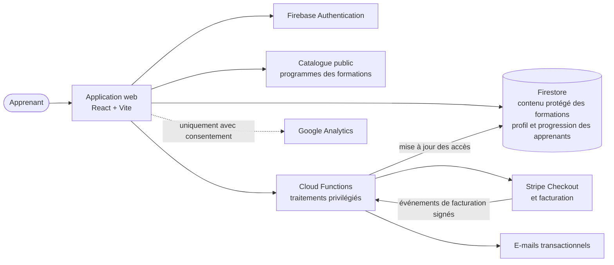
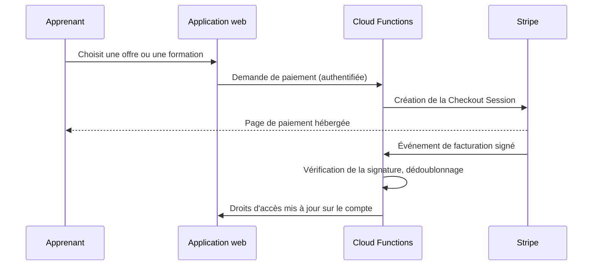

# Vue d'ensemble de la plateforme

*English version: [platform-overview.md](platform-overview.md)*

**Produit :** Module, [bymodule.com](https://bymodule.com)
**Dernière mise à jour :** 30 septembre 2026
**Périmètre :** l'organisation de la plateforme, au niveau de l'architecture produit. Le code source de production, les règles de sécurité, les identifiants internes, les endpoints et le contenu des formations payantes ne sont volontairement pas publiés.

Chaque fonctionnalité ci-dessous porte un statut, avec le même vocabulaire que dans le reste du dépôt :

| Statut | Signification |
| --- | --- |
| **Livré** | Mis en place et en ligne en production. |
| **En cours** | Construit ou en construction, pas encore en ligne. |
| **Observé** | Étayé par un usage réel ou par des éléments qualitatifs. |
| **Hypothèse** | Quelque chose que je compte tester ; aucun effet n'est revendiqué. |

---

## 1. Le système en un coup d'œil

Module est une plateforme de formation bilingue (français / anglais) pour les professionnels qui construisent des produits numériques. C'est une application React monopage, adossée à Firebase et à Stripe.

Le schéma montre des responsabilités, pas une topologie de déploiement ni une spécification des autorisations.

**Technologies livrées :** React 19, Vite, Tailwind CSS 4 avec les composants shadcn/ui, Firebase Authentication, Firestore (hébergé dans l'UE, région de Paris), Firebase Cloud Functions, Stripe, un prestataire d'e-mails transactionnels, Cloudflare Pages pour le domaine public, Vitest et Playwright pour les tests automatisés.

---

## 2. Principe : l'accès est une règle métier, pas un état visuel

La décision d'architecture la plus importante est qu'**un paywall dans l'interface n'est pas une protection**. Si le contenu payant est envoyé au navigateur, le cacher derrière un bouton ne le protège pas.

La plateforme sépare donc deux types de données :

| | Données publiques des formations | Contenu protégé des formations |
| --- | --- | --- |
| **Exemples** | Titre, description, niveau, durée, plan des modules et des leçons, objectifs pédagogiques | Contenu des leçons, exercices, prompts, ateliers |
| **Où elles se trouvent** | Livrées avec l'application web, chargées à la demande | Stockées côté serveur, lues uniquement après connexion |
| **Qui peut les lire** | Tout le monde | Uniquement les comptes qui ont droit à cette formation |

Les droits d'accès sont évalués côté serveur à partir de l'état du compte de l'apprenant :

- essai gratuit actif ;
- abonnement actif ;
- achat de la formation à l'unité ;
- rôles opérationnels (administration, traduction).

Les vérifications côté client servent uniquement à adapter l'interface. La même décision est appliquée là où les données sont stockées, et un contrôle avant chaque mise en production analyse le bundle public pour vérifier qu'aucun texte de leçon protégé n'y a fuité. **(Livré)**

---

## 3. Découverte des formations et apprentissage

- **Catalogue et pages des formations.** Les apprenants peuvent parcourir le catalogue, le filtrer et lire le programme complet d'une formation, ses objectifs et le livrable attendu avant d'ouvrir la moindre leçon. **(Livré)**
- **Lecteur de cours.** Les leçons sont présentées étape par étape, avec la progression enregistrée sur le compte de l'apprenant, un menu des modules, la navigation au clavier et un thème clair ou sombre. Le contenu est chargé dans la langue de l'apprenant. Si une formation n'existe pas dans cette langue, le lecteur le dit explicitement au lieu d'afficher l'autre langue sans prévenir. **(Livré)**
- **Tableau de bord.** Il propose la reprise là où l'apprenant s'était arrêté, ses formations, sa progression et le temps passé, ses certificats, des ressources et les réglages. **(Livré)**
- **Questions d'auto-évaluation.** Les leçons comprennent des quiz avec des explications. Les réponses restent dans la session du navigateur de l'apprenant. Elles ne sont **pas** enregistrées comme un modèle des connaissances de l'apprenant et ne constituent **pas** une évaluation par l'IA. **(Livré)**
- **Les certificats** sont délivrés à la fin d'une formation. Ils attestent qu'une formation a été suivie, pas que sa maîtrise a été évaluée. **(Livré)**
- **Onboarding à la première connexion.** Un onboarding en cinq questions (rôle, objectif, niveau, centres d'intérêt, temps disponible par semaine) recommande la formation la plus pertinente et un rythme réaliste. **(Livré)**

---

## 4. Le contenu comme donnée structurée

Les formations sont écrites sous forme de fichiers sources structurés, pas de mises en page. Un compilateur de contenu les valide par rapport à un standard de contenu et produit des sorties distinctes pour des usages distincts :

| Sortie | Utilisée par | Contient |
| --- | --- | --- |
| Programme public | Catalogue, pages des formations, recherche | Métadonnées, plan, objectifs |
| Contenu de lecture | Lecteur de cours (protégé) | Contenu des leçons, exercices, questions d'auto-évaluation |
| Couche de connaissances | Côté serveur uniquement, réservée à un usage futur | Faits typés, notions, recommandations, évaluations |

Le standard de contenu définit la structure des leçons, les objectifs pédagogiques, les prérequis, les idées reçues, les sources avec leur date de vérification, et les évaluations. Un lint automatique le fait respecter. Les contrôles des quiz rejettent par exemple les schémas de réponses qui trahissent la bonne option. **(Livré)**

Le catalogue compte aujourd'hui 31 formations, chacune écrite en français et en anglais. Le compilateur garantit la cohérence de la structure. Il ne garantit pas la qualité pédagogique, qui est relue séparément. **(Livré)**

La couche de connaissances est le socle d'un futur travail de recherche documentaire automatisée. **Elle ne signifie pas qu'un système de recherche documentaire ou un Learning Copilot est déployé.** Voir §8.

---

## 5. Facturation et droits d'accès

- Les sessions de paiement sont créées côté serveur, uniquement pour les utilisateurs authentifiés, avec une limite de fréquence. **(Livré)**
- Les événements de facturation sont vérifiés, dédoublonnés et appliqués côté serveur. Le navigateur ne s'accorde jamais d'accès lui-même. **(Livré)**
- Trois modèles commerciaux partagent un seul modèle de droits d'accès : l'essai gratuit, l'abonnement mensuel et l'achat à la formation. Cela permet de tester les prix sans modifier l'expérience des formations. **(Livré)**

---

## 6. Les langues

Le français et l'anglais sont traités à égalité, pas comme une couche de traduction ajoutée à la fin. **(Livré)**

- La langue fait partie de l'URL (`/fr/…`, `/en/…`). Les chemins d'URL eux-mêmes sont traduits, et la langue ne change que lorsque l'apprenant la choisit.
- Tous les textes de l'interface passent par un seul système de traduction. Des tests automatiques font échouer le build si une clé manque dans une langue ou si un texte non traduit est écrit en dur dans un composant.
- Une suite de tests de bout en bout parcourt tout le produit dans les deux langues et signale tout texte dans la mauvaise langue.
- Le contenu des formations est rédigé dans les deux langues, avec une parité de structure imposée.

---

## 7. Données personnelles et mesure d'audience

- **Le consentement d'abord.** La mesure d'audience et la mesure marketing sont séparées et ne se chargent qu'après consentement. Les apprenants peuvent rouvrir leurs choix de cookies à tout moment. **(Livré)** Retirer des données d'événements le texte libre saisi par l'apprenant, comme les recherches, fait partie du travail sur les données personnelles décrit ci-dessous. **(En cours)**
- **Localisation des données.** Les données des apprenants dans Firestore sont stockées dans l'UE. Certains sous-traitants (authentification, paiement, e-mail, mesure d'audience) opèrent depuis les États-Unis dans le cadre du Data Privacy Framework UE-États-Unis. **(Livré)**
- **Droits sur les données en libre-service.** Deux fonctionnalités sont en construction :
  - le téléchargement de toutes les données personnelles sous forme d'archive lisible, accompagnée d'un fichier lisible par une machine ;
  - la suppression du compte avec un délai de grâce, la résiliation de l'abonnement, la suppression chez chaque sous-traitant, et uniquement la conservation exigée par la loi.

  **(En cours)**
- **Maturité de la mesure.** Des événements sont instrumentés sur l'acquisition, l'inscription, l'apprentissage et le paiement. Des événements instrumentés ne sont pas un funnel validé : l'activation n'a pas encore été définie à partir de données. **(Livré / Observé)**

---

## 8. Ce que cette architecture prépare

La prochaine question produit vient de l'usage, pas de la technologie : les formations menées à leur terme jusqu'ici l'ont été dans un cadre accompagné, avec un formateur. L'apprentissage autonome, à son rythme, n'est pas encore démontré. **(Observé)**

Le modèle de travail pour y répondre est **TROUVER → APPRENDRE → VÉRIFIER → RETENIR** : aider les apprenants à choisir quoi apprendre, les aider en contexte, vérifier leur compréhension au regard d'objectifs explicites, et garder une trace de ce qu'ils ont appris. **(Hypothèse)**

L'architecture va dans cette direction sans la revendiquer :

- **TROUVER** commence avec la recommandation de l'onboarding. **(Livré)**
- **APPRENDRE** et **VÉRIFIER** reposent sur le contenu structuré et la couche de connaissances. **(Livré : socle)**
- Un **Learning Copilot** contextuel et l'enregistrement des connaissances de l'apprenant ne sont **pas construits**. **(Hypothèse)**

---

## 9. Qualité et exploitation

- Des tests unitaires, des tests des règles de sécurité et des tests de bout en bout dans le navigateur sont lancés avant chaque mise en production. Ils couvrent le contrôle d'accès, les deux langues et les principaux parcours des apprenants. Des audits visuels et d'accessibilité sont menés lors des changements importants de l'interface. **(Livré)**
- Le site public se déploie automatiquement quand une modification est fusionnée. Les modifications du backend et des règles de la base de données sont déployées séparément, après relecture. **(Livré)**

---

## Ce que ce document ne contient pas

Il ne contient ni code source de production, ni règles de sécurité, ni identifiants internes, ni configuration des endpoints ou de l'infrastructure, ni données d'utilisateurs, ni identifiants de connexion, ni contenu des leçons payantes. Il décrit l'architecture telle qu'elle a été conçue et livrée ; ce n'est ni un audit de sécurité ni une certification.
